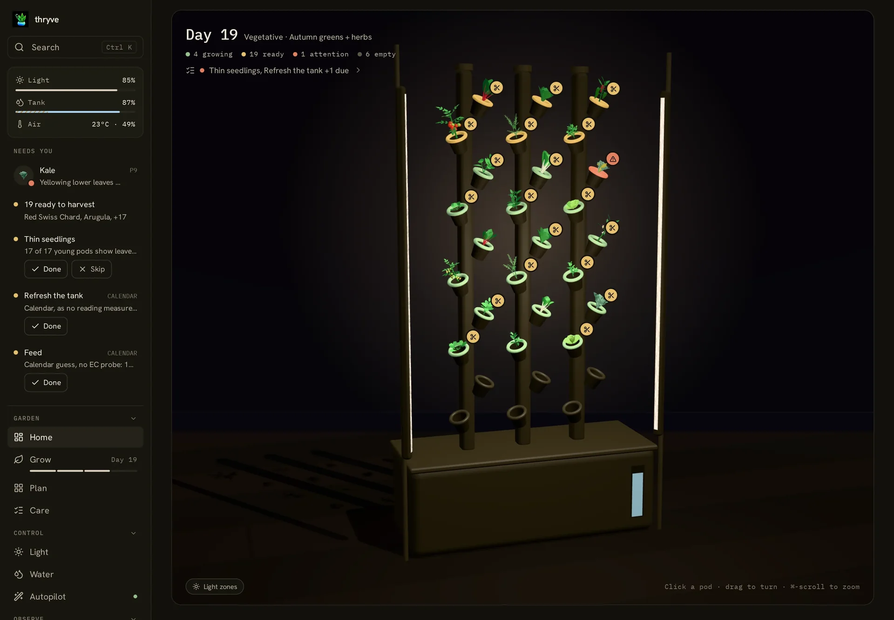

<h1 align="center">
  <picture>
    <source media="(prefers-color-scheme: dark)" srcset="web/public/brand/dark/horizontal.png" />
    <source media="(prefers-color-scheme: light)" srcset="web/public/brand/light/horizontal.png" />
    
  </picture>
</h1>
<p align="center"><strong>Your garden, your rules.</strong> Thryve replaces the Gardyn cloud with software on the tower's own Raspberry Pi: light, water, sensors and cameras on your network, Autopilot and camera growth analysis, an MCP server so AI agents can plan your pods, and HomeKit and Home Assistant built in.</p>
<p align="center">
  <a href="https://github.com/kaniick/Thryve/actions/workflows/test.yml"></a>
  <a href="https://github.com/kaniick/Thryve/actions/workflows/rust.yml"></a>
  <a href="https://codecov.io/gh/kaniick/Thryve"></a>
  <a href="https://github.com/kaniick/Thryve/releases/latest"></a>
  <a href="LICENSE"></a>
  <a href="docs/"></a>
</p>
<p align="center">
  <a href="docs/INSTALLATION.md">Get started</a> ·
  <a href="docs/">User guide</a> ·
  <a href="docs/MIGRATION.md">Migrate from seedypod</a> ·
  <a href="https://github.com/kaniick/Thryve/issues">Issues</a>
</p>
<p align="center">
  
</p>

A Gardyn has a Raspberry Pi inside and a cloud subscription in front of it. Thryve replaces the cloud with software that runs on that Pi. There's no account and no telemetry, and nothing leaves your LAN unless you turn it on. It's a sibling of [sleepypod](https://sleepypod.github.io/).

**No Gardyn?** Run `pnpm dev` (below). It serves the real web UI against a simulated tower. The original seedypod project also has a [hosted demo](https://seedypod.vercel.app).

## How it works

| Part | What it does |
|---|---|
| **`hald`** (Rust) | Owns the pins and buses: the light, pump, sensors, cameras and button. A safety guard checks every pump and dose command. It publishes over MQTT with Home Assistant discovery. |
| **core** (TypeScript) | Runs scheduling, grow cycles, Autopilot rules, camera analysis and alerts. It serves a React web UI, a tRPC/REST API and an [MCP](https://modelcontextprotocol.io) endpoint for AI agents. |

## Features

- **Light and water:** Auto light that follows the sun, with its hours from the grow protocol, or light curves of your own; watering that follows the grow protocol's stages, or one of your own schedules. A change on the Light page holds the light until the curve's next change, for an hour, or until you resume.
- **Autopilot:** WHEN/IF/THEN rules over live readings. Rules run as dry-runs until you arm them, and a backtest shows what one would have done.
- **Grow tracking:** grow cycles with reminders, the tower in 3D (pods colored by status and sized by measured growth, the tank's water level, the light bars at their level) or as a table, and camera captures with per-pod growth trends.
- **Probes:** add pH, EC and water-temperature probes from the app, with guided calibration.
- **Integrations:** Home Assistant over MQTT, MCP for agents, optional capture mirroring to S3-compatible storage, and dataset export.
- **iPhone app:** the tower in 3D, pod cards, light, water and alerts, from the original [seedypod/ios](https://github.com/seedypod/ios). The official app still looks up `_seedypod._tcp`; a Thryve build is not in this repo. See [the app's docs](https://seedypod.github.io/ios/).
- **Wi-Fi setup:** hold the button for 10 seconds to start a setup hotspot.
- **SD card care:** logs and swap stay in RAM, a meter shows the card's writes per day, and nightly backups go to your bucket. A dead card is a reflash plus **Welcome → Restore from a backup**.

> **Status:** running on a real Gardyn 3.0 (Pi Zero W) since 2026-11-06. Verified on that unit: both installers and thryve OS, the grow light, the sensors, both cameras with image analysis, HomeKit pairing and the web UI. Not yet verified, because its tank is still empty: a pump run and the water-level reading against water. The cameras' USB hub still comes up on only some boots. See the [bring-up notes](docs/HANDOFF.md#7-real-unit-bring-up-2026-11-06) and the [hardware map](docs/hardware/pin-map.md).

## Install

Back up the stock microSD card first, then follow [docs/INSTALLATION.md](docs/INSTALLATION.md). The quickest way is to [flash thryve OS](docs/INSTALLATION.md#flash-thryve-os-recommended), which has everything on it. On a fresh Raspberry Pi OS Lite, or to update, install the hardware daemon, then core:

Already running seedypod on the tower? Don't reflash. Follow [docs/MIGRATION.md](docs/MIGRATION.md).

```sh
curl -fsSL https://raw.githubusercontent.com/kaniick/Thryve/dev/scripts/install-hal | bash
curl -fsSL https://raw.githubusercontent.com/kaniick/Thryve/dev/scripts/install | bash
```

Both run on the original Pi Zero W that Gardyn ships and on a Pi Zero 2 W. Core prefers Node 24, which needs a 64-bit OS; on a 32-bit Pi, such as the Zero W, the installer uses Node 22 instead. Node 22 gets security fixes until April 2027, so a Zero 2 W (about $15, a drop-in swap) on 64-bit Raspberry Pi OS is the long-term setup. `scripts/install --check` says which Node a machine gets; [Which Pi](docs/INSTALLATION.md#which-pi) has the details.

## Development

No hardware is needed. `pnpm dev` runs core against a simulated HAL. Use the Node in `.node-version` (24); CI also tests on Node 22, the version 32-bit Pis run, so keep to APIs both have.

The logo and icon PNGs under `web/public/brand/` are stored with [Git LFS](https://git-lfs.com). Install it before you clone, or the images check out as small text pointer files and the app shows broken logos. A unit doesn't need LFS: `scripts/install` downloads a tarball that CI builds with the images in it.

```sh
brew install git-lfs     # or your package manager
git lfs install          # once per machine
git lfs pull             # in a clone made without LFS
```

```sh
pnpm install
pnpm dev                 # core on :3000, web on :5173
API_TARGET=http://thryve.local:3000 pnpm dev:web   # the web UI against a real unit
API_TARGET=http://thryve.local:3000 API_KEY=… pnpm dev:web   # … one with an API key (sent by the dev proxy, never bundled)
pnpm test                # Vitest
pnpm hal:test            # cargo test
pnpm lint && pnpm tsc
```

The REST spec is at `http://localhost:3000/api/openapi.json`, and the MCP endpoint is `POST /api/mcp`.

## Contributing

`dev` is the integration branch, and `main` is release-only. Use conventional commits. A PR into `main` cuts a release, so its title must start with `feat:`, `fix:`, `perf:` or `revert:`. Read [AGENTS.md](AGENTS.md) and the [ADRs](docs/adr/) before changing hardware, safety or schema code.

## This fork

Thryve is a fork of [seedypod](https://github.com/seedypod/core) by Jonathan Ng and contributors. It keeps the same [AGPL-3.0-only](LICENSE) license, the sleepypod design-system credit, and the garden-of-eden hardware acknowledgements. See [NOTICE](NOTICE) for the full attribution and modification notice.

## License

[AGPL-3.0](LICENSE).

Thryve is a clean-room implementation and uses no code from [iot-root/garden-of-eden](https://github.com/iot-root/garden-of-eden) (GPL-3). That project's pin map and bug history were invaluable references and are credited in [docs/hardware/pin-map.md](docs/hardware/pin-map.md).
